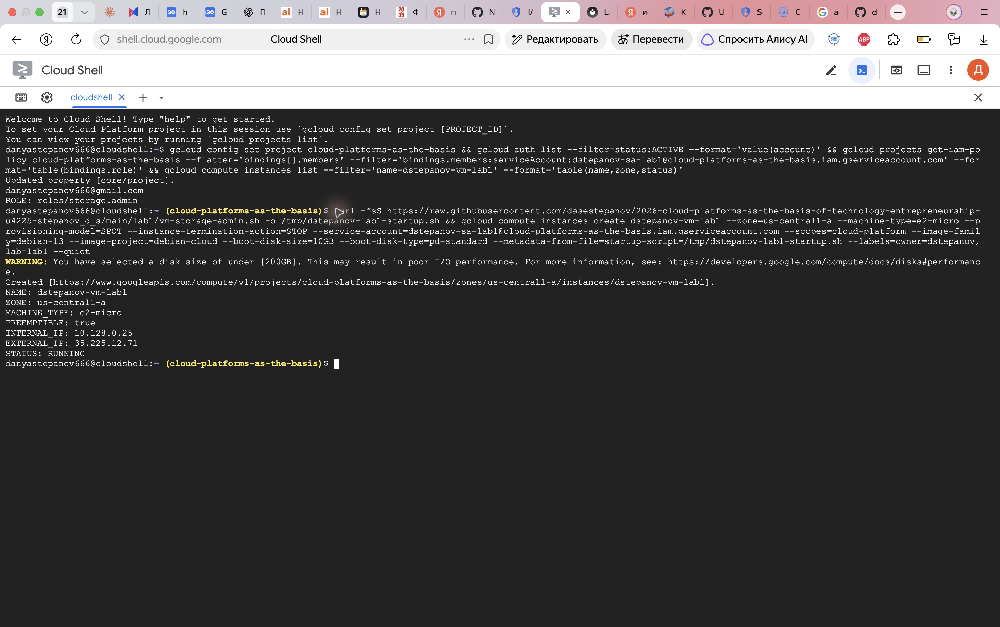
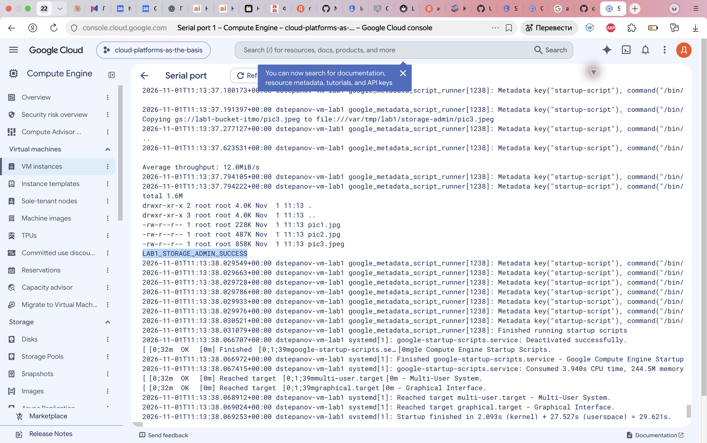
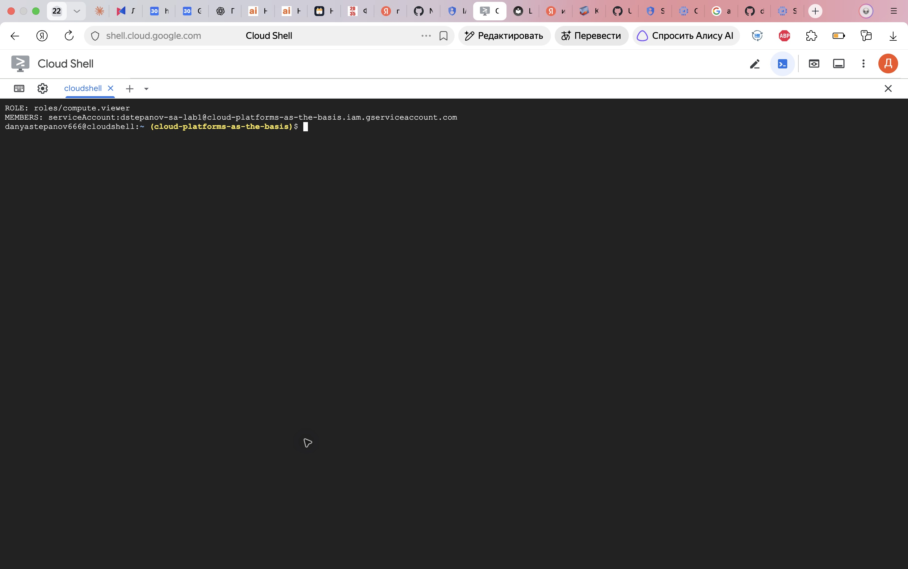
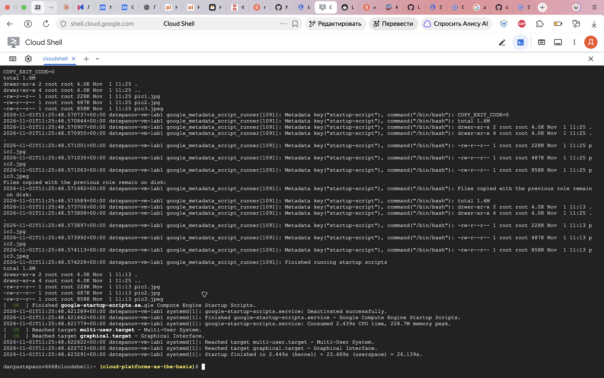
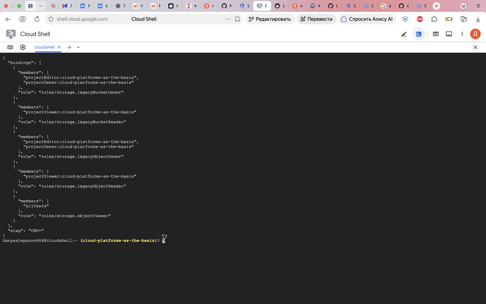
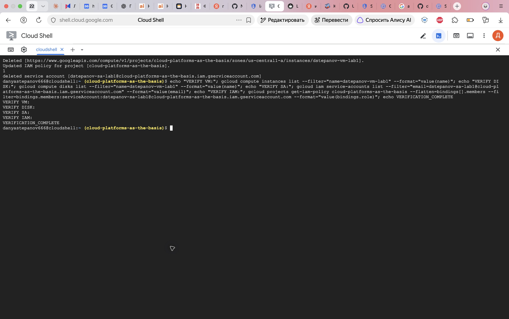

University: [ITMO University](https://itmo.ru/ru/)  
Faculty: [FICT](https://fict.itmo.ru)  
Course: [Cloud platforms as the basis of technology entrepreneurship](https://ex-itmo-ict-faculty.github.io/cloud-platforms-as-the-basis-of-technology-entrepreneurship/)  
Year: 2026  
Group: U4225  
Author: Stepanov Daniil Sergeevich  
Lab: Lab1  
Date of create: 01.11.2026  
Date of finished: — (заполняется после защиты)

# Лабораторная работа №1 «Обзор Google Cloud и исследование основных сервисов»

## Цель работы

Ознакомиться с основными возможностями Google Cloud, исследовать Compute Engine, Cloud Storage и управление доступом через IAM.

## Параметры работы

Проект: `cloud-platforms-as-the-basis`. Сервисный аккаунт: `dstepanov-sa-lab1@cloud-platforms-as-the-basis.iam.gserviceaccount.com`. VM: `dstepanov-vm-lab1`, зона `us-central1-a`, тип `e2-micro`, модель предоставления Spot. ОС Debian 13, загрузочный диск Standard Persistent Disk 10 ГБ. Исходный бакет: `gs://lab1-bucket-itmo`.

## Ход работы

### 1. Создание сервисного аккаунта

В IAM & Admin → Service accounts создан аккаунт `dstepanov-sa-lab1`. В учебном проекте ему назначена роль `Storage Admin`. Ключи аккаунта не создавались.


Рисунок 1 — назначение роли Storage Admin.


Рисунок 2 — результат создания сервисного аккаунта.

### 2. Создание виртуальной машины

Из Cloud Shell создана VM с подготовленным скриптом запуска. Команды обращения к Storage выполнялись внутри VM от её сервисного аккаунта, а Cloud Shell использовался для управления VM и чтения журнала.

```bash
gcloud compute instances create dstepanov-vm-lab1 \
  --zone=us-central1-a --machine-type=e2-micro \
  --provisioning-model=SPOT --instance-termination-action=STOP \
  --service-account=dstepanov-sa-lab1@cloud-platforms-as-the-basis.iam.gserviceaccount.com \
  --scopes=cloud-platform --image-family=debian-13 \
  --image-project=debian-cloud --boot-disk-size=10GB \
  --boot-disk-type=pd-standard \
  --metadata-from-file=startup-script=/tmp/dstepanov-lab1-startup.sh
```



Рисунок 3 — VM создана и запущена, тип e2-micro, PREEMPTIBLE=true.

### 3. Поиск бакета и копирование файлов

Скрипт [vm-storage-admin.sh](vm-storage-admin.sh) проверил адрес аккаунта через metadata server, запросил сведения о бакете, получил список объектов и скопировал первые три объекта в локальную папку VM.

```bash
gcloud storage buckets describe gs://lab1-bucket-itmo
gcloud storage ls 'gs://lab1-bucket-itmo/**'
gcloud storage cp gs://lab1-bucket-itmo/pic1.jpg \
  gs://lab1-bucket-itmo/pic2.jpg gs://lab1-bucket-itmo/pic3.jpeg \
  /var/tmp/lab1/storage-admin/
ls -lah /var/tmp/lab1/storage-admin/
```

Копирование завершилось успешно, в журнале присутствует `LAB1_STORAGE_ADMIN_SUCCESS`. Вывод `ls -lah` подтвердил три файла:

| Файл | Размер в ls -lah |
|---|---|
| pic1.jpg | 228K |
| pic2.jpg | 487K |
| pic3.jpeg | 858K |



Рисунок 4 — журнал VM: копирование и вывод ls -lah.

### 4. Замена роли и повторное копирование

Роль `roles/storage.admin` удалена, назначена `roles/compute.viewer`. Запрос политики проекта подтвердил, что этому сервисному аккаунту назначена Compute Viewer.

```bash
gcloud projects remove-iam-policy-binding cloud-platforms-as-the-basis \
  --member=serviceAccount:dstepanov-sa-lab1@cloud-platforms-as-the-basis.iam.gserviceaccount.com \
  --role=roles/storage.admin
gcloud projects add-iam-policy-binding cloud-platforms-as-the-basis \
  --member=serviceAccount:dstepanov-sa-lab1@cloud-platforms-as-the-basis.iam.gserviceaccount.com \
  --role=roles/compute.viewer
```



Рисунок 5 — проверка роли сервисного аккаунта.

На VM установлен скрипт [vm-compute-viewer.sh](vm-compute-viewer.sh), после чего VM перезапущена. Те же три объекта копировались в новую папку `/var/tmp/lab1/compute-viewer/`. Фактический результат: `COPY_EXIT_CODE=0`, все три файла появились в новой папке. Файлы, скопированные ранее, сохранились в `/var/tmp/lab1/storage-admin/`.



Рисунок 6 — повторное копирование завершилось успешно после замены роли.

Для объяснения результата проверена политика бакета:

```bash
gcloud storage buckets get-iam-policy gs://lab1-bucket-itmo --format=json
```

Обнаружено разрешение `allUsers` → `roles/storage.objectViewer`. Следовательно, объекты учебного бакета доступны публично. Успех повторного копирования объясняется этим дополнительным разрешением, а не наличием доступа к Storage в роли Compute Viewer. Политика общего бакета не изменялась.



Рисунок 7 — allUsers имеет Storage Object Viewer на учебном бакете.

### 5. Удаление ресурсов

После проверки удалены VM `dstepanov-vm-lab1` вместе с загрузочным диском, привязка Compute Viewer и созданный сервисный аккаунт. Общий бакет и ресурсы других студентов не изменялись.



Рисунок 8 — удаление ресурсов и проверка их отсутствия.

## Результаты и выводы

Созданы сервисный аккаунт и Spot VM e2-micro. С помощью gcloud внутри VM найдены и скопированы три объекта Cloud Storage; их наличие подтверждено ls -lah. После замены Storage Admin на Compute Viewer копирование повторено и также завершилось успешно, поскольку бакет предоставляет публичное чтение через allUsers.

IAM оценивает совокупность применимых разрешений: удаление одной роли не исключает доступ, предоставленный другой политикой. Compute Viewer предназначена для просмотра ресурсов Compute Engine и сама по себе не даёт права чтения объектов Storage. Для демонстрации отказа потребовался бы непубличный бакет без дополнительных разрешений; общий учебный бакет в рамках работы не изменялся. Ранее скачанные файлы остаются на диске независимо от последующего изменения облачных прав. Созданные учебные ресурсы удалены.
