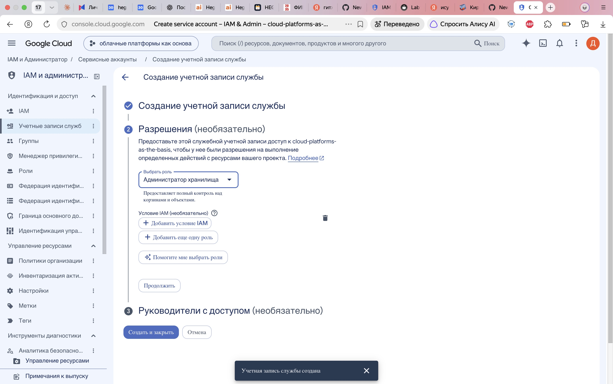
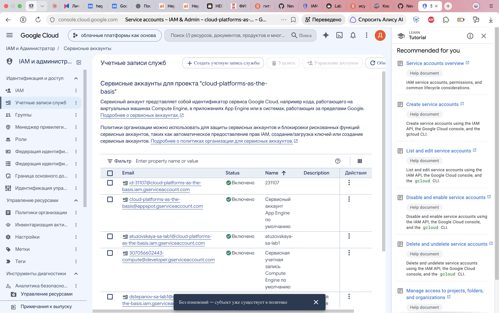

University: [ITMO University](https://itmo.ru/ru/)  
Faculty: [FICT](https://fict.itmo.ru)  
Course: [Cloud platforms as the basis of technology entrepreneurship](https://ex-itmo-ict-faculty.github.io/cloud-platforms-as-the-basis-of-technology-entrepreneurship/)  
Year: 2026  
Group: U4225  
Author: Stepanov Daniil Sergeevich  
Lab: Lab1  
Date of create: 01.11.2026  
Date of finished: — (заполняется после защиты)

# Лабораторная работа №1 «Обзор Google Cloud и исследование основных сервисов»

> Работа выполняется. Создание сервисного аккаунта и назначение Storage Admin выполнены. VM и проверка копирования пока не выполнены; отчёт не готов к сдаче.

## Цель работы

Ознакомиться с основными возможностями и преимуществами облачной платформы Google Cloud, исследовать Compute Engine, Cloud Storage и управление доступом через IAM.

## Параметры работы

- Проект: `cloud-platforms-as-the-basis`.
- Сервисный аккаунт: `dstepanov-sa-lab1`.
- Виртуальная машина: `dstepanov-vm-lab1`.
- Тип машины: `e2-micro`, модель предоставления: Spot.
- Исходный бакет: `gs://lab1-bucket-itmo`.

## Ход работы

### 1. Создание сервисного аккаунта

В разделе IAM & Admin → Service accounts создан сервисный аккаунт `dstepanov-sa-lab1` с описанием назначения для лабораторной работы. Адрес: `dstepanov-sa-lab1@cloud-platforms-as-the-basis.iam.gserviceaccount.com`. Назначена роль `Storage Admin` в учебном проекте. Ключи сервисного аккаунта не создавались.

Рисунок 1 — выбор роли Storage Admin перед её сохранением.

Рисунок 2 — созданный сервисный аккаунт в списке аккаунтов проекта.

### 2. Создание виртуальной машины

Предстоит создать Spot VM типа `e2-micro` и подключить созданный сервисный аккаунт. Для проверки IAM следует использовать именно этот аккаунт при обращении к Cloud Storage.

### 3. Копирование трёх файлов

Предстоит найти бакет через `gcloud`, скопировать три файла в локальную папку VM и зафиксировать результат `ls -lah`.

### 4. Проверка после изменения роли

Предстоит заменить роль сервисного аккаунта `Storage Admin` на `Compute Viewer`, повторить копирование в другую папку и записать фактический результат. При проверке необходимо учитывать задержку применения IAM и возможные дополнительные разрешения аккаунта.

### 5. Удаление ресурсов

Предстоит удалить созданную VM вместе с её загрузочным диском, созданный сервисный аккаунт и назначенные ему роли. Общий учебный бакет не удаляется.

## Результаты и выводы

Будут заполнены после выполнения практической части на основании наблюдаемых результатов.
