University: [ITMO University](https://itmo.ru/ru/)  
Faculty: [FICT](https://fict.itmo.ru)  
Course: [Cloud platforms as the basis of technology entrepreneurship](https://ex-itmo-ict-faculty.github.io/cloud-platforms-as-the-basis-of-technology-entrepreneurship/)  
Year: 2026  
Group: U4225  
Author: Stepanov Daniil Sergeevich  
Lab: Lab2  
Date of create: 01.11.2026  
Date of finished: — (заполняется после защиты)

# Лабораторная работа №2 «Исследование Cloud Run»

## Цель работы

Ознакомиться с работой Cloud Run: развёртыванием контейнера, просмотром журналов и метрик, настройкой порта и управлением трафиком между ревизиями.

## Использованные ресурсы

| Параметр | Значение |
|---|---|
| Проект | `cloud-platforms-as-the-basis` |
| Регион | `us-central1` |
| Сервис | `dstepanov-hello-lab2` |
| Образ | `us-docker.pkg.dev/cloudrun/container/hello` |
| CPU / память | 0,08 vCPU / 128 МиБ |
| Среда выполнения | First generation |
| Параллельные запросы на экземпляр | 1 |
| Масштабирование | минимум 0, максимум 1 экземпляр на ревизию |
| Оплата | Request-based, CPU throttling включён, startup CPU boost отключён |
| Сервисный аккаунт | `dstepanov-sa-lab2@cloud-platforms-as-the-basis.iam.gserviceaccount.com` |

Выбрана минимальная конфигурация CPU 0,08 vCPU; для неё необходимы первая среда выполнения, request-based billing и concurrency=1. Память — минимальные 128 МиБ для первой среды. Отдельному сервисному аккаунту не назначались проектные роли и не создавались ключи.

## Ход работы

### 1. Развёртывание Hello

В Cloud Shell под аккаунтом `danyastepanov666@gmail.com` создан отдельный сервисный аккаунт и развёрнут стандартный Hello. Для тестирования разрешён неаутентифицированный вызов только этого демонстрационного сервиса.

```bash
gcloud iam service-accounts create dstepanov-sa-lab2
gcloud run deploy dstepanov-hello-lab2 \
  --image=us-docker.pkg.dev/cloudrun/container/hello \
  --region=us-central1 --platform=managed \
  --cpu=0.08 --memory=128Mi --concurrency=1 \
  --min-instances=0 --max-instances=1 \
  --execution-environment=gen1 --cpu-throttling --no-cpu-boost \
  --port=8080 --revision-suffix=p8080 \
  --service-account=dstepanov-sa-lab2@cloud-platforms-as-the-basis.iam.gserviceaccount.com \
  --allow-unauthenticated
```

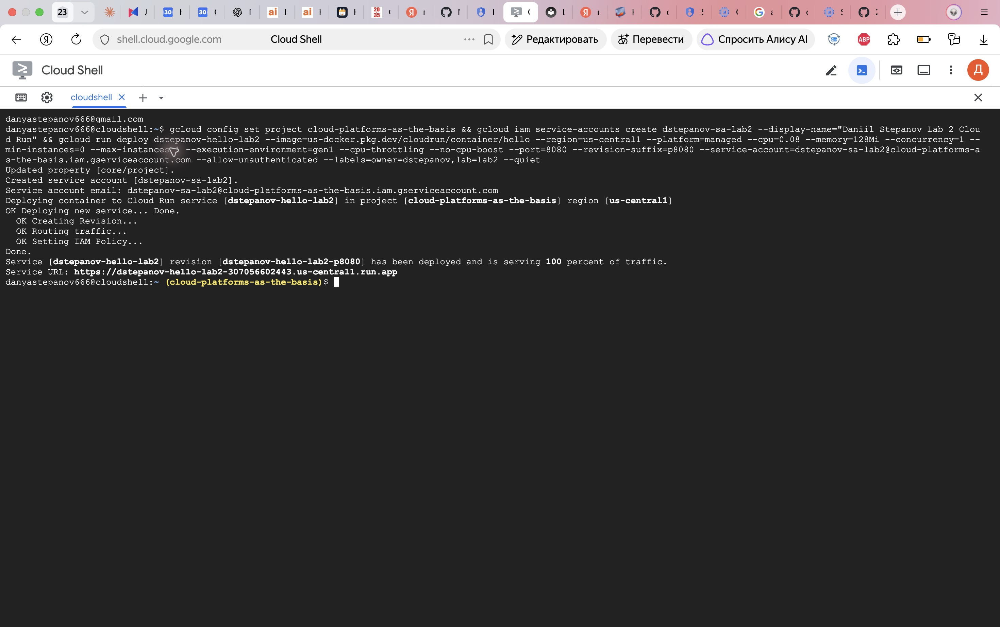

Рисунок 1 — создана ревизия `dstepanov-hello-lab2-p8080`, ей назначено 100% трафика.

### 2. Проверка сервиса

Cloud Run выдал URL `https://dstepanov-hello-lab2-307056602443.us-central1.run.app`. При открытии в браузере отображается страница «It's running!» с именем сервиса, проекта, региона и текущей ревизии. Дополнительные последовательные запросы curl возвращали HTTP 200.

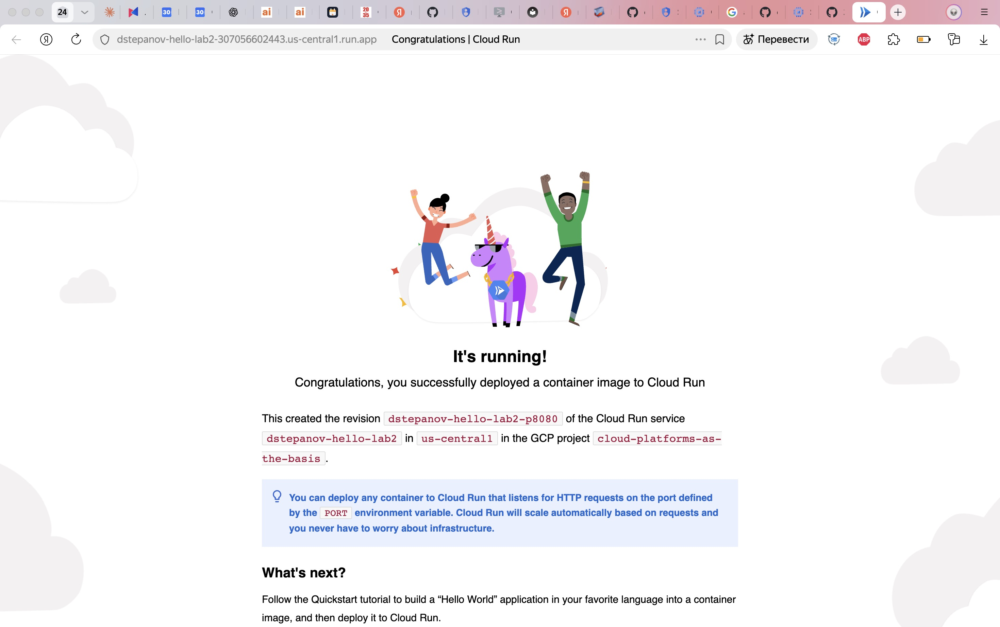

Рисунок 2 — работающая страница Hello на ревизии с портом 8080.

### 3. Анализ логов и метрик

Открыт раздел Observability → Metrics. На момент фиксации графиков видны успешные ответы 2xx. В доступном небольшом наборе точек Request latencies находились в диапазоне примерно 5,8–87,3 мс; End-to-end request latency — 63,2–781,4 мс. Это разные показатели: полная задержка включает дополнительные этапы доставки и ожидания, поэтому она больше времени обработки запроса.

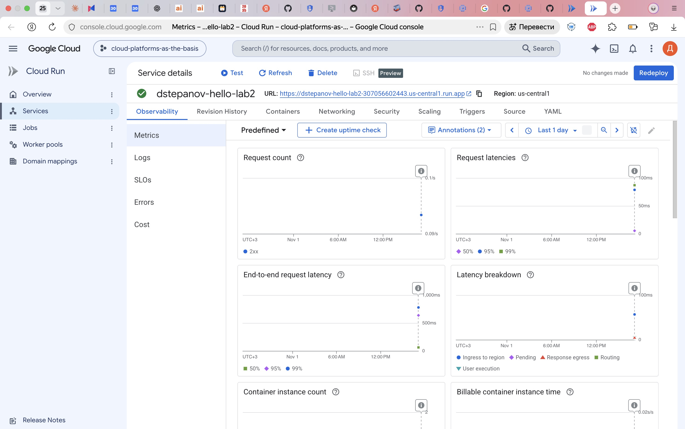

Рисунок 3 — количество запросов, перцентили задержек и составляющие полной задержки.

На графиках ресурсов наблюдался один экземпляр; CPU utilization — примерно 3,8–13%, memory utilization — 16,5–17% от лимита. Для небольшого Hello ресурсов достаточно. Это короткая функциональная проверка, а не нагрузочный тест; по ней нельзя оценить предельную производительность или гарантировать задержки под нагрузкой. При min-instances=0 возможен холодный старт.

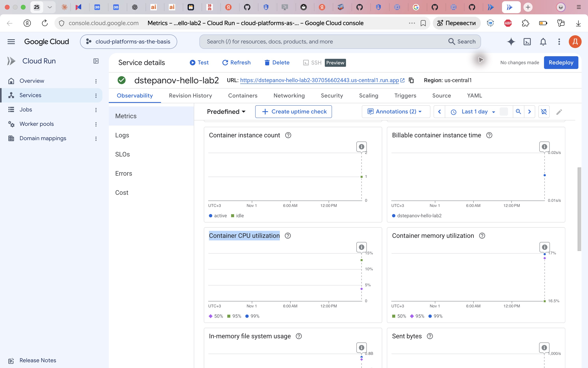

Рисунок 4 — число экземпляров и загрузка CPU/памяти.

В Observability → Logs обнаружены записи создания сервиса, запуска контейнера на порту 8080 и успешной TCP startup probe с первой попытки. Ревизия перешла в Ready=True. Для GET-запросов видны код 200, размер ответа, задержка и клиент (браузер либо curl). Большинство показанных запросов curl обрабатывались за 2–3 мс, отдельные — дольше. Ошибки запуска на этом этапе не наблюдались.

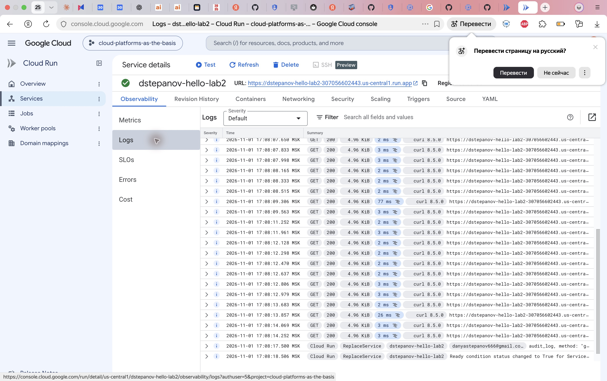

Рисунок 5 — успешные GET-запросы и события Cloud Run.

### 4. Изменение порта на 8090

Создана вторая ревизия без немедленного перевода трафика:

```bash
gcloud run services update dstepanov-hello-lab2 \
  --region=us-central1 --port=8090 \
  --revision-suffix=p8090 --no-traffic
```

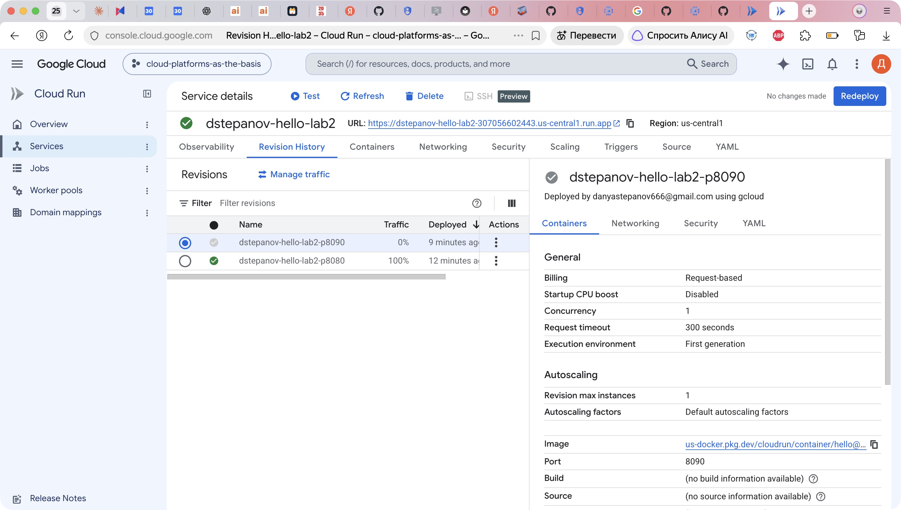

Рисунок 6 — ревизия p8090 с портом контейнера 8090; p8080 пока получает 100% трафика.

Через Manage traffic весь трафик переведён на последнюю ревизию p8090.

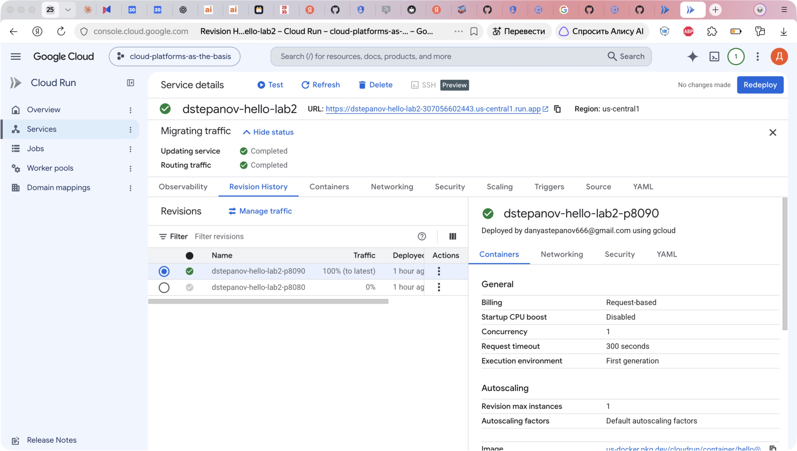

Рисунок 7 — 100% трафика направлено на p8090.

Обновление прежнего URL показало ту же страницу Hello, но имя ревизии изменилось на `dstepanov-hello-lab2-p8090`. Сервис остался работоспособным. Hello использует переменную окружения `PORT`, которую задаёт Cloud Run; поэтому смена порта согласованно меняет порт слушающего приложения. Если бы приложение жёстко слушало 8080, изменение только настройки Cloud Run могло бы привести к провалу startup probe и неготовности новой ревизии. В данном эксперименте такого отказа не произошло.

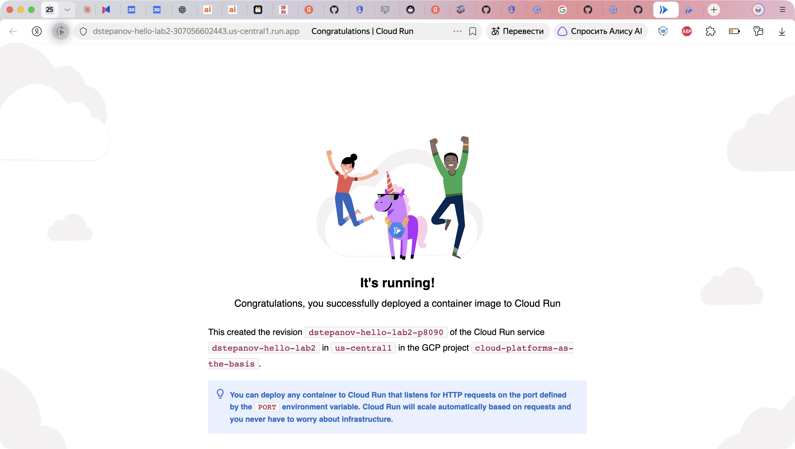

Рисунок 8 — браузер получает ответ p8090.

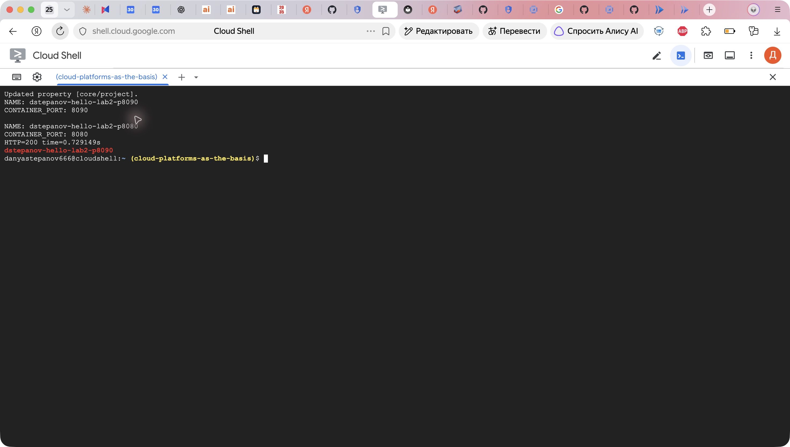

Рисунок 9 — проверка обеих конфигураций и HTTP 200 от p8090.

### 5. Переключение трафика и сравнение ревизий

Весь трафик возвращён на старую ревизию:

```bash
gcloud run services update-traffic dstepanov-hello-lab2 \
  --region=us-central1 --to-revisions=dstepanov-hello-lab2-p8080=100
```

Повторный запрос вернул HTTP 200 и имя p8080. Таким образом, откат не потребовал пересборки контейнера или изменения URL.

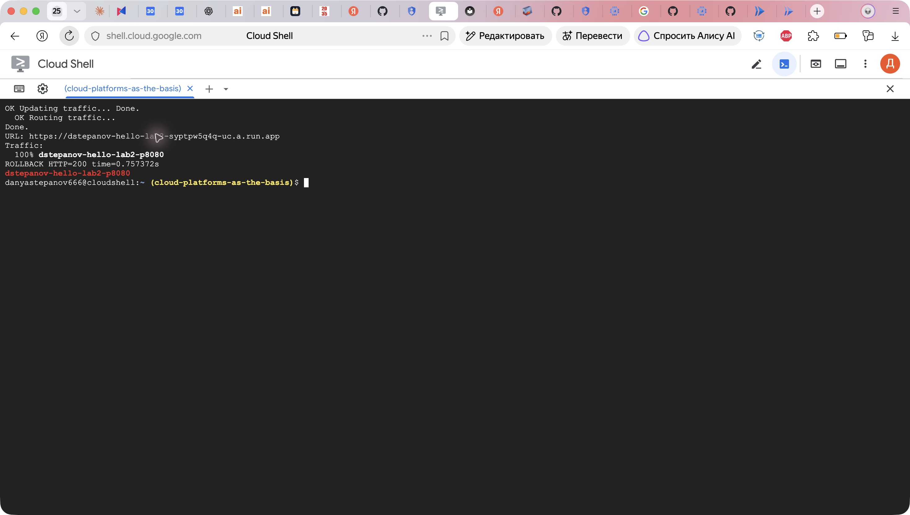

Рисунок 10 — 100% трафика на p8080, подтверждён успешный ответ старой ревизии.

Затем настроено распределение 50/50 и выполнено 20 последовательных запросов без сохранения cookies:

```bash
gcloud run services update-traffic dstepanov-hello-lab2 \
  --region=us-central1 \
  --to-revisions=dstepanov-hello-lab2-p8080=50,dstepanov-hello-lab2-p8090=50
for lab_i in $(seq 1 20); do
  curl -fsS https://dstepanov-hello-lab2-307056602443.us-central1.run.app/ \
    | grep -o "dstepanov-hello-lab2-p[0-9]*"
done | sort | uniq -c
```

В этой выборке получено 10 ответов p8080 и 10 ответов p8090. Настройка процентов задаёт распределение трафика, а не обязательное строгое чередование; другая небольшая выборка может дать иное соотношение.

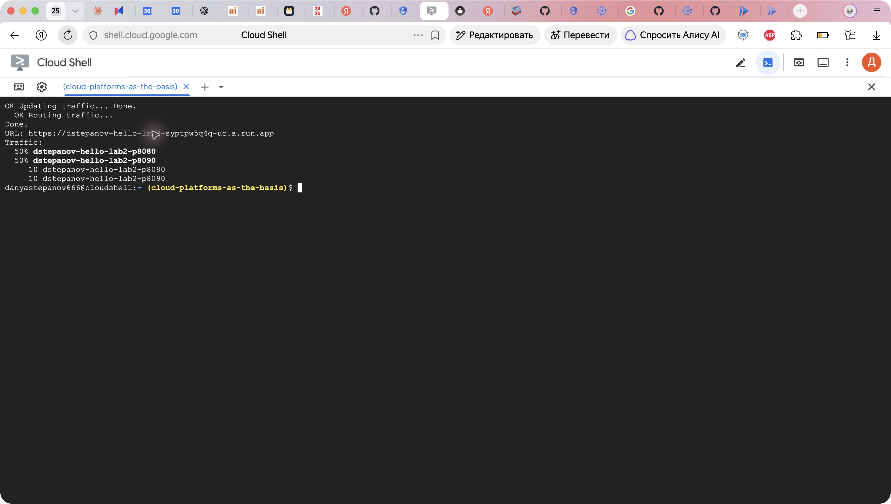

Рисунок 11 — обе ревизии получают запросы по одному URL.

Дополнительно проверены журналы p8090: контейнер сообщает, что слушает 8090, TCP startup probe проходит с первой попытки.

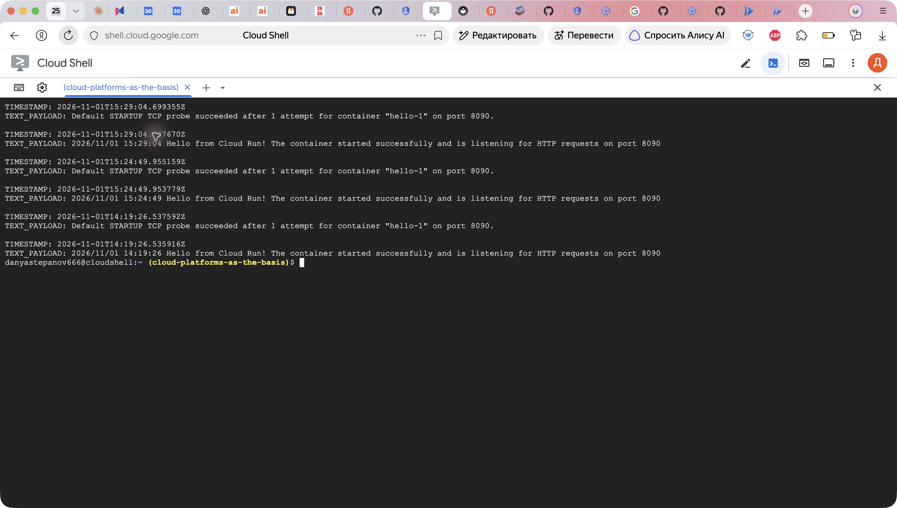

Рисунок 12 — успешный запуск и проверка готовности на порту 8090.

| Проверка | Результат |
|---|---|
| Исходная p8080 | Страница Hello, HTTP 200 |
| 100% на p8090 | Та же страница, имя p8090, HTTP 200 |
| Откат 100% на p8080 | Имя p8080, HTTP 200 |
| 50/50, 20 запросов | 10 ответов каждой ревизии |

Содержимое приложения одинаковое: использован один образ Hello. Отличаются настройки порта и имя ревизии в ответе. Из отдельных замеров времени нельзя сделать вывод, что один номер порта быстрее другого: влияют сеть, прогрев и холодный старт.

### 6. Удаление ресурсов

```bash
gcloud run services delete dstepanov-hello-lab2 --region=us-central1 --quiet
gcloud iam service-accounts delete \
  dstepanov-sa-lab2@cloud-platforms-as-the-basis.iam.gserviceaccount.com --quiet
```

Удаление сервиса удаляет его ревизии и настройки трафика. Дополнительно удалён созданный для работы сервисный аккаунт. Собственные образы, репозитории Artifact Registry, Cloud Build jobs и VM не создавались: использовался готовый публичный образ Google. После удаления выданный сервису URL больше не является работающим результатом — результат сохранён в скриншотах.

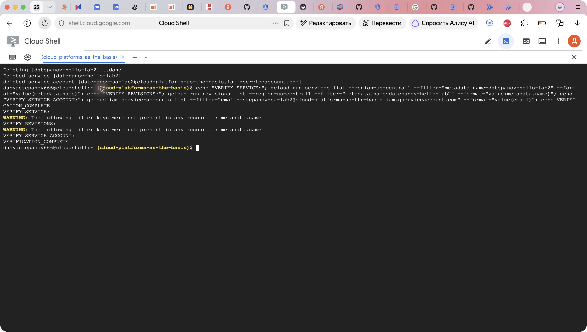

Рисунок 13 — удаление сервиса и аккаунта, проверка отсутствия ресурсов.

## Вывод

Cloud Run позволяет разворачивать контейнер без управления VM, автоматически масштабировать экземпляры и наблюдать запросы через логи и метрики. Изменение конфигурации порта создаёт отдельную ревизию. В стандартном Hello порт не зафиксирован в коде: приложение учитывает PORT, поэтому переход 8080 → 8090 сохранил работоспособность. Проверены перевод всего трафика, откат и распределение 50/50. Обе ревизии успешно обслуживали запросы; созданные ресурсы удалены.

## Использованные материалы

- [Настройка CPU и ограничения дробного CPU](https://docs.cloud.google.com/run/docs/configuring/services/cpu).
- [Лимиты памяти](https://docs.cloud.google.com/run/docs/configuring/services/memory-limits).
- [Контракт контейнера: адрес и порт прослушивания, PORT](https://docs.cloud.google.com/run/docs/container-contract).
- [Переключение трафика и откат](https://docs.cloud.google.com/run/docs/rollouts-rollbacks-traffic-migration).
