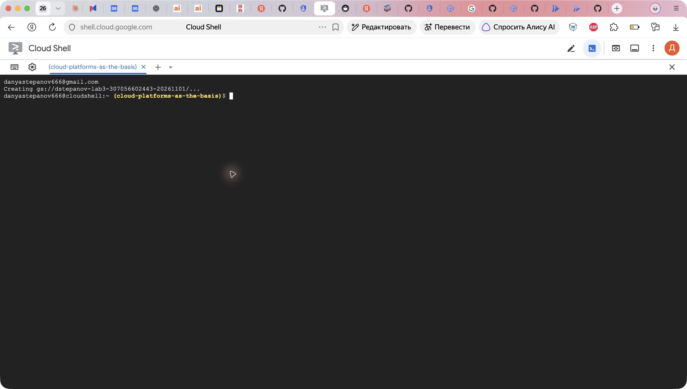
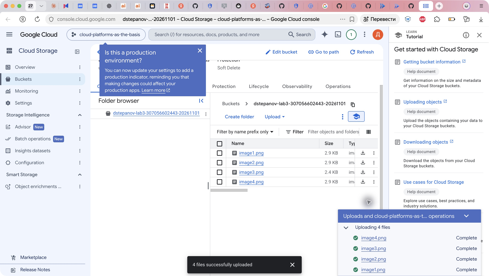
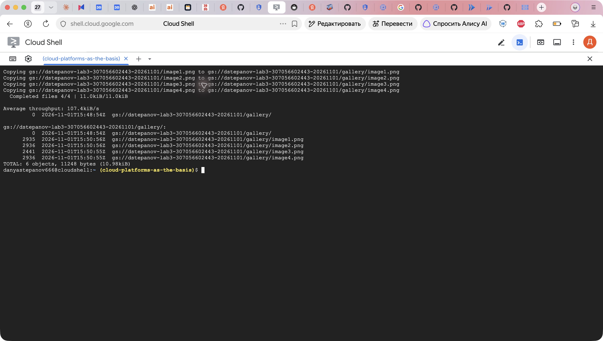
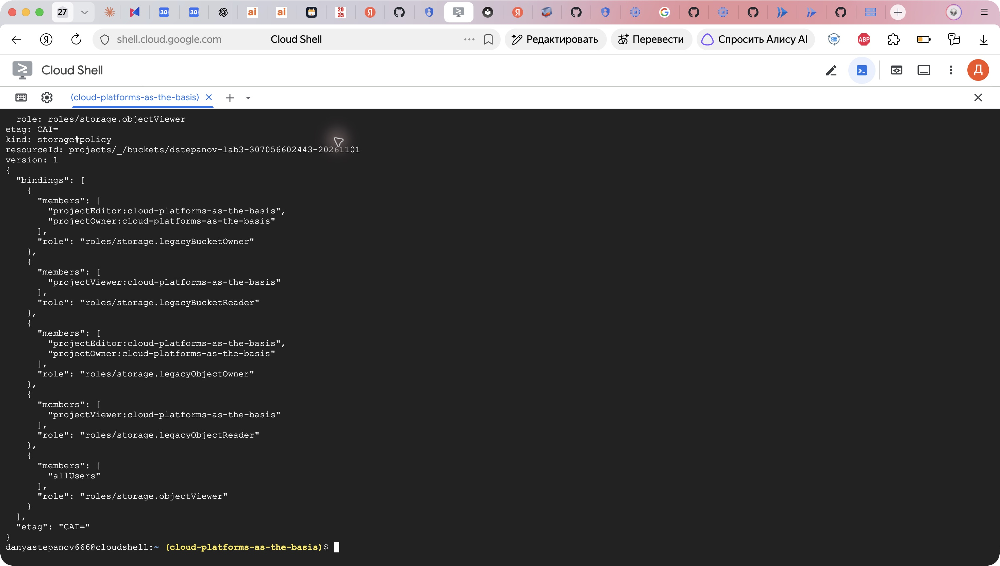
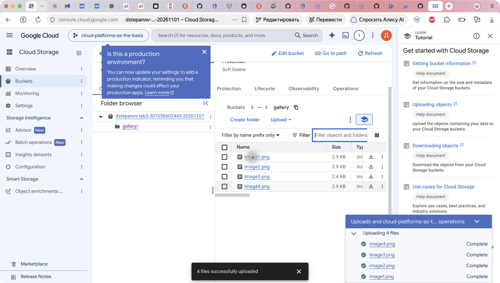
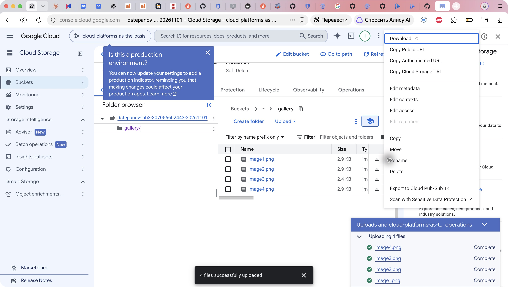
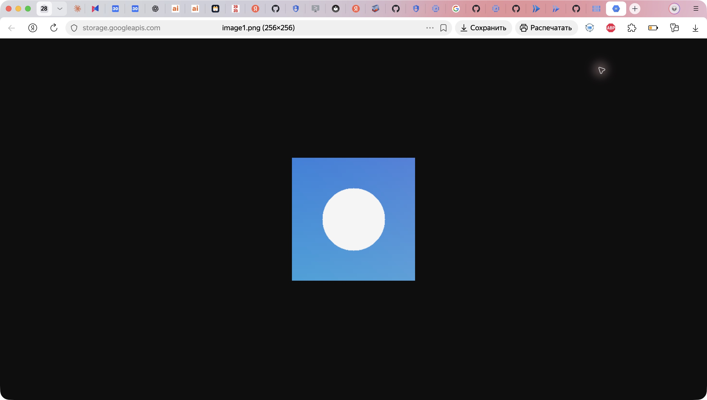
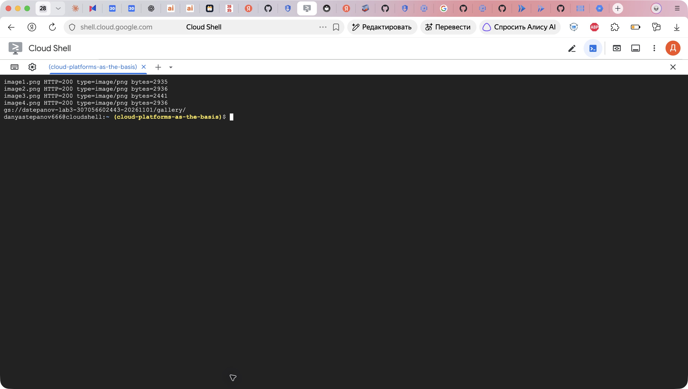
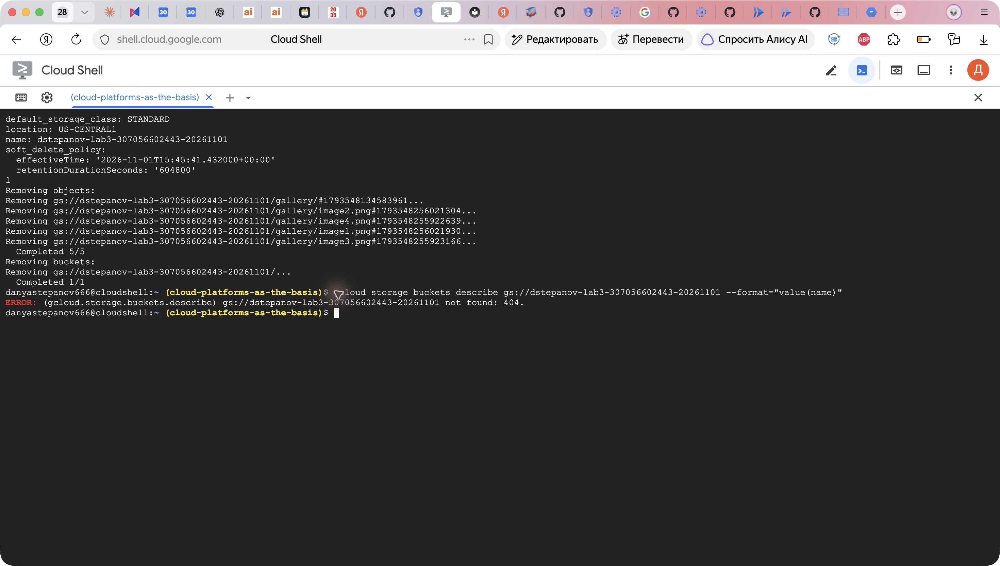

University: [ITMO University](https://itmo.ru/ru/)  
Faculty: [FICT](https://fict.itmo.ru)  
Course: [Cloud platforms as the basis of technology entrepreneurship](https://ex-itmo-ict-faculty.github.io/cloud-platforms-as-the-basis-of-technology-entrepreneurship/)  
Year: 2026  
Group: U4225  
Author: Stepanov Daniil Sergeevich  
Lab: Lab3  
Date of create: 01.11.2026  
Date of finished: — (заполняется после защиты)

# Лабораторная работа №3 «Исследование Cloud Storage»

## Цель работы

Ознакомиться с понятиями облачного хранения, сравнить блочную, файловую и объектную модели. На практике создать бакет Cloud Storage, загрузить изображения, организовать их в папку и проверить публичный доступ.

## Модели хранения

| Модель | Единица и способ доступа | Типичное применение | Пример в Google Cloud |
|---|---|---|---|
| Блочная | Том с адресуемыми блоками; файловую систему создаёт ОС | Диски VM, базы данных | Persistent Disk / Hyperdisk |
| Файловая | Файлы и каталоги общей файловой системы, например через NFS | Общие каталоги приложений и пользователей | Filestore |
| Объектная | Объект с именем, данными и метаданными; доступ через API/HTTP | Изображения, архивы, резервные копии | Cloud Storage |

Cloud Storage в данной работе используется как объектное хранилище. Бакет задаёт область размещения и политики доступа. В выбранном плоском пространстве имён папка `gallery/` представляется префиксом имён объектов; это не отдельная файловая система.

## Параметры работы

- Студент: Степанов Даниил Сергеевич, U4225.
- Аккаунт Google Cloud: `danyastepanov666@gmail.com`.
- Существующий проект: `cloud-platforms-as-the-basis`.
- Бакет: `dstepanov-lab3-307056602443-20261101`.
- Регион: `us-central1`, класс хранения Standard.
- Uniform bucket-level access: включён; разрешения задаются через IAM бакета.
- Данные: четыре самостоятельно подготовленных тестовых PNG 256×256, без личных данных. Исходные изображения сохранены в репозитории: [image1](image1.png), [image2](image2.png), [image3](image3.png), [image4](image4.png).

## Ход работы

### 1. Создание бакета

В открытом Cloud Shell проверен активный аккаунт и создан отдельный бакет в существующем учебном проекте:

```bash
gcloud auth list --filter=status:ACTIVE --format='value(account)'
gcloud storage buckets create gs://dstepanov-lab3-307056602443-20261101 \
  --project=cloud-platforms-as-the-basis --location=us-central1 \
  --default-storage-class=STANDARD --uniform-bucket-level-access
```



Рисунок 1 — создание бакета под нужным аккаунтом.

### 2. Загрузка изображений

В Cloud Storage → Objects через Upload files выбраны четыре локальных изображения. Консоль подтвердила `4 files successfully uploaded`. Изначально файлы размещались в корне бакета и отмечались как Not public.



Рисунок 2 — четыре PNG в корне бакета до публикации.

### 3. Создание папки и перемещение файлов

Кнопкой Create folder создана папка `gallery`. Затем выполнено перемещение в пределах того же бакета:

```bash
gcloud storage mv \
  'gs://dstepanov-lab3-307056602443-20261101/image*.png' \
  gs://dstepanov-lab3-307056602443-20261101/gallery/
gcloud storage ls --long gs://dstepanov-lab3-307056602443-20261101/gallery/
```

Все четыре операции завершились успешно. В корне после перемещения остался только `gallery/`. В журнале mv видны операции Copying: для плоского пространства имён смена пути выполняется через копирование объекта с новым именем и удаление прежнего. Нулевой объект-маркер `gallery/` не является пятым изображением; вывод ls с префиксами может показывать его дополнительно.



Рисунок 3 — четыре PNG получили префикс gallery/.

### 4. Настройка публичного чтения

Для созданного бакета назначено разрешение `allUsers` → `roles/storage.objectViewer`:

```bash
gcloud storage buckets add-iam-policy-binding \
  gs://dstepanov-lab3-307056602443-20261101 \
  --member=allUsers --role=roles/storage.objectViewer
gcloud storage buckets get-iam-policy \
  gs://dstepanov-lab3-307056602443-20261101 --format=json
```

Эта роль позволяет публично читать объекты и просматривать их список, но не загружать или удалять файлы. Политика назначена только выделенному бакету Lab3; политики проекта и чужих бакетов не изменялись.



Рисунок 4 — allUsers имеет Storage Object Viewer.



Рисунок 5 — все четыре файла в gallery/ отмечены как доступные публичным принципалам.

### 5. Получение ссылок и проверка доступа

В меню объекта (три точки) выбран пункт **Copy Public URL**. Полученная ссылка первого файла вставлена в адресную строку и открыта в браузере. Для остальных изображений использован тот же пункт меню.



Рисунок 6 — получение публичной ссылки через меню файла.

Публичные URL во время выполнения работы:

| Файл | URL | Размер, байт | Результат HTTP |
|---|---|---:|---|
| image1.png | `https://storage.googleapis.com/dstepanov-lab3-307056602443-20261101/gallery/image1.png` | 2935 | 200, image/png |
| image2.png | `https://storage.googleapis.com/dstepanov-lab3-307056602443-20261101/gallery/image2.png` | 2936 | 200, image/png |
| image3.png | `https://storage.googleapis.com/dstepanov-lab3-307056602443-20261101/gallery/image3.png` | 2441 | 200, image/png |
| image4.png | `https://storage.googleapis.com/dstepanov-lab3-307056602443-20261101/gallery/image4.png` | 2936 | 200, image/png |



Рисунок 7 — image1.png открывается по публичному URL.

Для проверки без учётных данных выполнены обычные curl-запросы без Authorization и без cookies:

```bash
for lab_n in 1 2 3 4; do
  curl -sS -o /tmp/lab3-image${lab_n}.png \
    -w "image${lab_n}.png HTTP=%{http_code} type=%{content_type} bytes=%{size_download}\n" \
    https://storage.googleapis.com/dstepanov-lab3-307056602443-20261101/gallery/image${lab_n}.png
done
```

Все четыре запроса вернули 200 и image/png; размеры совпали с загруженными файлами. Публичная ссылка отличается от authenticated URL: она позволяет читать объект без входа в Google. Копирование URL само по себе не меняет права — доступ появился после назначения IAM-роли.



Рисунок 8 — все четыре объекта доступны без авторизации.

### 6. Удаление ресурсов

После проверки удалена привязка allUsers, затем рекурсивно удалён созданный бакет вместе с содержимым:

```bash
gcloud storage buckets remove-iam-policy-binding \
  gs://dstepanov-lab3-307056602443-20261101 \
  --member=allUsers --role=roles/storage.objectViewer
gcloud storage rm --recursive gs://dstepanov-lab3-307056602443-20261101
```



Рисунок 9 — удаление объектов и бакета, контроль отсутствия активного бакета.

Указанные выше публичные ссылки приведены как результат эксперимента; после очистки они не предназначены для дальнейшего использования. В настройках бакета зафиксирован soft delete со сроком 604800 секунд (7 дней): удалённые данные сохраняются на этот срок восстановления и не отображаются как активные объекты. Общий учебный проект, исходный бакет первой лабораторной и ресурсы других студентов не удалялись.

## Результаты и выводы

Создан бакет Standard в us-central1, загружены четыре PNG, создана папка gallery и выполнено перемещение объектов. Настроено публичное чтение, ссылки получены через контекстное меню; браузер и четыре запроса curl подтвердили доступ. После работы созданный бакет и его активные объекты удалены.

В отличие от блочной и файловой моделей, Cloud Storage работает с целыми объектами и их метаданными через API. Папка в плоском пространстве имён служит способом группировки по префиксу. Публичность определяется политикой доступа, а не наличием URL; поэтому перед очисткой разрешение allUsers было отдельно отозвано.

## Использованные материалы

- [Публичный доступ к данным Cloud Storage](https://docs.cloud.google.com/storage/docs/access-control/making-data-public).
- [Объекты и их метаданные](https://docs.cloud.google.com/storage/docs/objects).
- [Требования к оформлению отчёта](https://ex-itmo-ict-faculty.github.io/cloud-platforms-as-the-basis-of-technology-entrepreneurship/education/labs2023-2024/reportdesign/).
