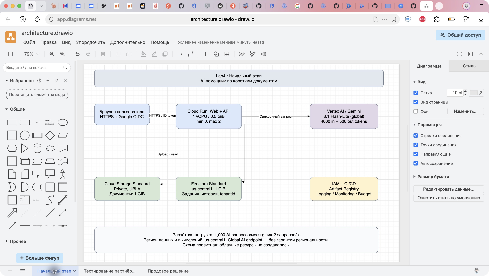
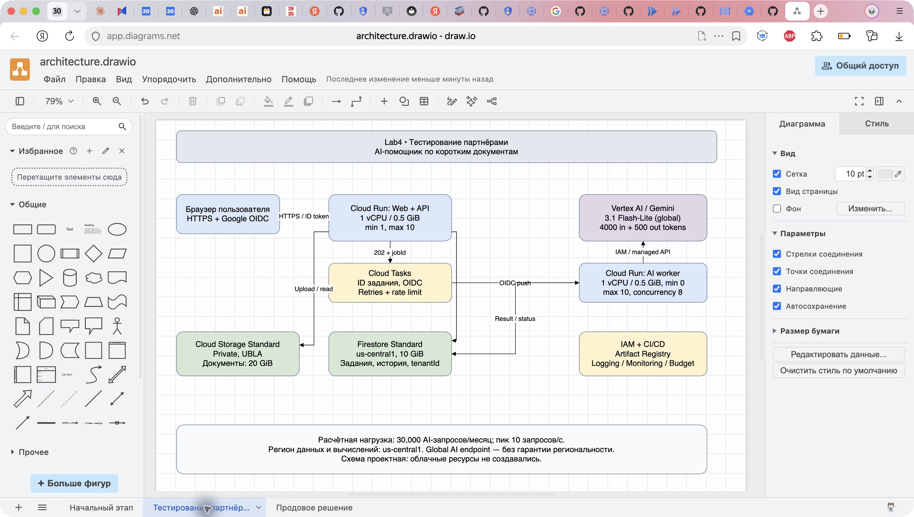
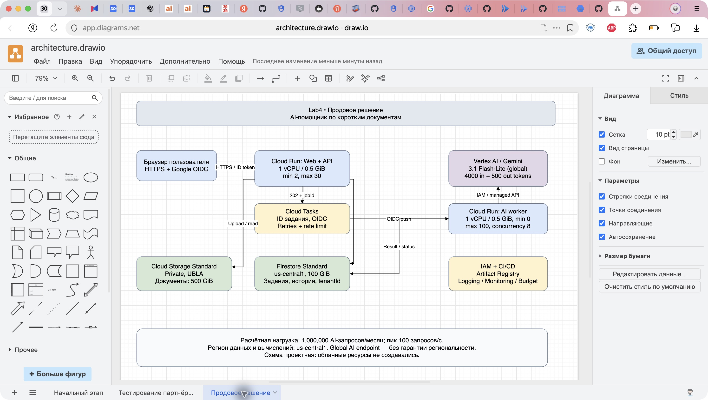

University: [ITMO University](https://itmo.ru/ru/)  
Faculty: [FICT](https://fict.itmo.ru)  
Course: [Cloud platforms as the basis of technology entrepreneurship](https://ex-itmo-ict-faculty.github.io/cloud-platforms-as-the-basis-of-technology-entrepreneurship/)  
Year: 2026  
Group: U4225  
Author: Stepanov Daniil Sergeevich  
Lab: Lab4  
Date of create: 01.11.2026  
Date of finished: — (заполняется после защиты)

# Лабораторная работа №4 «Разработка инфраструктуры MVP AI приложения»

## Цель и границы работы

Спроектировать инфраструктуру AI-приложения для начального этапа, тестирования партнёрами и промышленной эксплуатации; оценить расходы и обосновать развитие решения. Работа проектная: ресурсы в Google Cloud не создавались, нагрузочные испытания не выполнялись. Скриншоты показывают схемы в draw.io, а не действующее облачное окружение.

В опубликованном задании нет конкретного описания приложения и численных нагрузок. Поэтому ниже **явно приняты собственные расчётные допущения**, которые нужно заменить при появлении исходных данных преподавателя.

## 1. Исходные данные и сценарий MVP

Приложение «DocBrief» принимает короткий текстовый документ, формирует краткий пересказ и отвечает на вопрос по его содержимому. Пользователь входит через Google OIDC, загружает текст, запускает обработку и получает результат с историей заданий. Партнёры разделены по tenantId; доступ к документам проверяется на сервере.

Для MVP поддерживаются TXT и PDF с извлекаемым текстом до 1 MiB; сканы, OCR, обучение модели, поиск по большой базе и векторная БД в объём решения не входят. Сервер проверяет длину после извлечения: документ вместе с инструкцией и вопросом — максимум 8000 входных токенов. В расчёте среднее значение 4000; выход ограничен 500 оплачиваемыми токенами с учётом reasoning. Повторный вопрос снова оплачивает переданный контекст. Ограничения должны проверяться приложением, а не только интерфейсом.

| Параметр в месяц | Начальный | Партнёры | Прод |
|---|---:|---:|---:|
| Активные пользователи (допущение) | 20 | 500 | 10 000 |
| Успешные AI-запросы N | 1 000 | 30 000 | 1 000 000 |
| Средний RPS за 730 часов | 0,00038 | 0,0114 | 0,381 |
| Кратковременный пик AI RPS | 2 | 10 | 100 |
| Хранение документов, GiB (с версиями/soft delete) | 1 | 20 | 500 |
| Firestore с индексами, GiB | 1 | 10 | 100 |
| Исходящий интернет-трафик, GiB | 2 | 20 | 200 |
| Логи, GiB | 1 | 5 | 20 |

Один AI-запрос предполагает в среднем одну запись документа, одно чтение объекта, 10 чтений и 3 записи Firestore, 3 коротких HTTP-запроса API по 0,2 с и 8 с обработки AI. Это единицы расчёта, а не измеренные характеристики. Статика, получение статуса и ответы входят в API/трафик; частое polling сверх трёх запросов увеличит расходы. Размеры хранилищ — средние за месяц, не объём новых загрузок.

## 2. Схемы инфраструктуры в draw.io

[Редактируемый файл architecture.drawio](architecture.drawio) содержит три страницы. Файл открыт и проверен в diagrams.net; ниже настоящие скриншоты редактора. Цвета: синий — вычисления, зелёный — данные, фиолетовый — AI API, жёлтый — очередь и эксплуатация. Стрелки отражают основные связи; доступ worker к Storage описан в потоке ниже, чтобы не перегружать схему.

### Начальное состояние

Рисунок 1 — минимальная инфраструктура MVP.

Один Cloud Run контейнер обслуживает интерфейс, API и синхронный вызов AI. Выбрано 1 vCPU / 512 MiB, request-based billing, min=0, max=2, concurrency=8, таймаут запроса 60 с. Нулевой минимум экономит деньги при простое; холодный старт допустим. На этом этапе возможны очередь и задержки во время пика. Контейнер не хранит состояние локально: документы находятся в приватном Cloud Storage, история — в Firestore.

### Тестирование партнёрами

Рисунок 2 — выделение AI-обработчика и очереди.

API (1 vCPU / 512 MiB, min=1, max=10) записывает задание, ставит ссылку на него в Cloud Tasks и возвращает 202 + jobId. Очередь с OIDC вызывает приватный Cloud Run worker (1 vCPU / 512 MiB, min=0, max=10, concurrency=8). Worker читает документ из Storage, вызывает AI и сохраняет результат в Firestore. Клиент запрашивает статус через API. Данные документа не помещаются в сообщение очереди; размер сообщения до 32 KiB.

Повторы ограничены, применяются backoff и idempotency key. Статусы queued/running/done/failed и lease в транзакции Firestore не дают повторно записать результат; внешний AI-вызов при сбое всё равно может повториться и повторно тарифицироваться. Разрыв между записью задания и постановкой в очередь закрывается outbox: API при последующих обращениях повторяет отправку непоставленных заданий с детерминированным именем задачи. Перед продом нужен автоматический reconciler; его эксплуатационный запас учтён отдельной строкой.

### Продовое решение

Рисунок 3 — независимо масштабируемые API и worker.

API: min=2, max=30; worker: min=0, max=100; оба 1 vCPU / 512 MiB. API concurrency=40, worker=8. Базовый регион — us-central1; Storage и Firestore региональные. Выделяются отдельные проекты prod и test; таблица расходов относится к одному целевому окружению, параллельный staging оплачивается дополнительно.

При 8 с на вызов и concurrency=8 теоретическая пропускная способность одного worker — 1 запрос/с; 100 экземпляров — 100 запросов/с без запаса. Это верхняя оценка, не подтверждённая производительность. Пик буферизуется очередью: 100 RPS в течение 60 с создаёт 6000 заданий, которые при фактической производительности 50 RPS разгружаются примерно за 120 с, если новых заданий нет. Перед запуском измеряются CPU, память, p95 длительности, скорость очереди и токены/мин; затем повышаются max instances/квоты или ограничивается приём. Для 100 RPS требуется до 27 млн токенов/мин при 4500 токенах на запрос — доступность такой квоты не предполагается автоматически.

Проектная цель API: p95 приёма задания <1 с и 99,9% успешных обращений в месяц; время AI-результата зависит от очереди и квот. Это целевые SLO, не гарантия Google и не результат теста. Единственный регион не защищает от региональной аварии. Для MVP выбран режим восстановления: резервные копии Firestore и документы с политикой восстановления; целевые RPO до 24 ч и RTO до 4 ч проверяются учебным восстановлением до запуска. Межрегиональная репликация и active-active требуют отдельного бюджета и в оценку не включены.

## 3. Обоснование компонентов и безопасность

| Компонент | Причина выбора и ограничение |
|---|---|
| Cloud Run | Масштабирование без управления VM; один контейнер можно разделить на API/worker без переноса данных. Асинхронный I/O нужен для concurrency; 512 MiB проверяется на реальных PDF. |
| Cloud Tasks | Ограничивает скорость обращений к AI, повторяет временные ошибки. Worker завершает работу в HTTP-запросе; фоновый процесс после ответа не используется. |
| Managed Gemini API | Нет GPU, загрузки весов и оплаты постоянно работающей модели. Модель Gemini 3.1 Flash-Lite выбрана по опубликованной стандартной цене; качество и доступность проверяются перед внедрением, ID хранится в конфигурации. |
| Cloud Storage Standard | Объекты подходят для документов; частое чтение не требует платы за retrieval, характерной для холодных классов. Включены UBLA и запрет публичного доступа. |
| Firestore Standard | Состояние заданий, история, tenantId без постоянно работающего сервера БД. Не хранить PDF и большие тексты в документах; индексы только необходимые, без индексации больших результатов. |
| OIDC + IAM | API проверяет issuer/audience/expiry ID token, затем tenantId и квоты. Публичный HTTPS endpoint сам по себе не означает публичные данные. Неизвестные пользователи не допускаются. |
| Artifact Registry, CI/CD | Образы с фиксированным digest, отдельные ревизии Cloud Run, постепенный перевод трафика и откат. CI получает короткоживущие полномочия через federation, без JSON-ключей. |
| Logging / Monitoring | Статусы, длительность, размер очереди, 429/5xx и расходы. Тексты документов и токены доступа не логируются; логи хранятся 30 дней. |

API и worker получают разные service account и минимальные роли на конкретные ресурсы. Только worker имеет доступ к AI. Cloud Tasks может вызывать worker, обычный пользователь — нет. Загруженные документы считаются недоверенными: извлечение текста ограничивается памятью/временем, инструкции в документе не управляют инфраструктурой, у модели нет инструментов и доступа к чужим данным. Есть лимиты файла, токенов, запросов пользователя и организации; при исчерпании месячного лимита новые задания отклоняются. Billing Budget с уведомлениями 50/80/100% — сигнал, а не жёсткое отключение расходов.

Global endpoint AI не гарантирует обработку в us-central1. В модели разрешены только несекретные документы без требования региональности. Для других данных нужно выбрать подходящий региональный endpoint, пересчитать тариф и проверить требования к обработке.

## 4. Экономическая модель

Цены проверены 01.11.2026, USD, on-demand, без НДС, валютной конвертации, стартовых кредитов и committed-use скидок. Бесплатные квоты намеренно не вычитаются: они могут быть заняты другими проектами общего billing account. Поэтому оценка стартового окружения выше потенциального счёта с free tier.

| Параметр | Принятая ставка | Источник |
|---|---:|---|
| Gemini 3.1 Flash-Lite global, Standard | $0,25 / 1 млн входных; $1,50 / 1 млн выходных токенов | [AI pricing](https://cloud.google.com/model-garden/pricing) |
| Cloud Run active CPU / RAM | $0,000024 за vCPU·с; $0,0000025 за GiB·с | [Cloud Run](https://cloud.google.com/run/pricing) |
| Cloud Run idle min instance CPU / RAM | $0,0000025 за vCPU·с и GiB·с | [Cloud Run](https://cloud.google.com/run/pricing) |
| HTTP-запросы контейнера | $0,40 / 1 млн | [Cloud Run](https://cloud.google.com/run/pricing) |
| Storage Standard us-central1 | округлённо $0,02 / GiB·месяц; A $0,005 и B $0,0004 / 1000 операций | [Storage](https://cloud.google.com/storage/pricing) |
| Firestore us-central1 | $0,03 / 100 тыс. чтений; $0,09 / 100 тыс. записей; около $0,15 / GiB·месяц | [Firestore](https://cloud.google.com/firestore/pricing) |
| Firestore PITR / backup | резерв $0,15 + $0,03 / GiB·месяц | [Firestore](https://cloud.google.com/firestore/pricing) |
| Интернет в Европу/Северную Америку до 1 TiB | $0,12 / GiB | [Network](https://cloud.google.com/vpc/pricing) |
| Cloud Tasks | $0,40 / 1 млн операций; 2 операции на задачу без повторов | [Tasks](https://cloud.google.com/tasks/pricing) |
| Логи; образы | $0,50 / GiB логов; около $0,10 / GiB·месяц образов | [Logging](https://cloud.google.com/products/observability/pricing), [Registry](https://cloud.google.com/artifact-registry/pricing) |

Тарифы хранения приведены с округлением до месяца; фактическая тарификация может быть почасовой/посуточной. Объём резервных копий принят равным объёму БД, PITR — ещё одному объёму; реальная стоимость зависит от изменений и срока хранения. Для сборок, платных метрик/алертов, служебных операций и reconciler заложен плановый резерв $2/$10/$50. Это **не тариф одного продукта**. Услуги разработчика, поддержка Google, домен, платежи, OCR, сторонние интеграции, WAF/балансировщик, межрегиональная передача, второй регион и постоянно работающее тестовое окружение не включены.

### Формулы

Для N AI-вызовов:

- `C_AI = N × (4000 × 0.25 + 500 × 1.50) / 1e6 = N × $0.00175`.
- `S_active = N × 8 + 3N × 0.2 = 8.6N` — консервативная сумма длительностей запросов. При параллельной обработке на одном экземпляре перекрывающиеся секунды не оплачиваются дважды; для планирования не предполагается выигрыш от concurrency.
- `C_Run = S_active × (0.000024 + 0.5 × 0.0000025) + 4N × 0.40 / 1e6`.
- `C_warm ≤ min_API × 730 × 3600 × (0.0000025 + 0.5 × 0.0000025)`; полный месяц idle добавлен сверху как запас. Реально активные интервалы и idle не суммируются для одной секунды.
- `C_Storage = GiB × 0.02 + N/1000 × (0.005 + 0.0004)`.
- `C_DB = GiB × 0.15 + 10N/100000 × 0.03 + 3N/100000 × 0.09`.
- `C_network = GiB_out × 0.12`; чтения между сервисами одной локации не трактуются как интернет-выдача.
- `Плановый бюджет = сумма статей × 1.20`.

Четыре HTTP-запроса на AI-операцию — унифицированный запас: три обращения клиента и одно выполнение обработки. В начальном синхронном варианте часть этих обращений объединяется. Повторы AI, старты контейнеров, дополнительные чтения индексов и отклонения нагрузки покрываются резервом только в рамках его размера; это не строгая верхняя граница счёта.

### Расходы в месяц

| Статья, USD | Начальный | Партнёры | Прод |
|---|---:|---:|---:|
| AI inference | 1.75 | 52.50 | 1750.00 |
| Cloud Run: активная работа + запросы | 0.22 | 6.56 | 218.75 |
| Cloud Run: запас на тёплые API | 0.00 | 9.86 | 19.71 |
| Storage: данные + операции | 0.03 | 0.56 | 15.40 |
| Firestore: данные + операции | 0.16 | 1.67 | 20.70 |
| Firestore: backup + PITR | 0.18 | 1.80 | 18.00 |
| Исходящий трафик | 0.24 | 2.40 | 24.00 |
| Очередь | 0.00 | 0.02 | 0.80 |
| Логи | 0.50 | 2.50 | 10.00 |
| Образы | 0.10 | 0.30 | 1.00 |
| Плановый служебный резерв | 2.00 | 10.00 | 50.00 |
| Итого до резерва 20% | 5.17 | 88.17 | 2128.36 |
| Бюджет с резервом 20% | 6.20 | 105.81 | 2554.03 |

Машиночитаемые результаты: [CSV](costs.csv), [JSON](costs.json). Пересчёт: `python3 lab4/recalculate.py` из корня репозитория (только стандартная библиотека Python; облачных вызовов нет).

### Чувствительность и ограничения

На проде $1750 из $2128,36 до общего резерва приходится на AI — около 82%. Удвоение среднего входа до 8000 токенов увеличит AI-статью до $2750, полный бюджет с резервом — до $3754,03. Дополнительные 10% повторных AI-вызовов добавят $175 к этой статье до резерва; они также увеличат вычисления и операции. Удвоение интернет-выдачи с 200 до 400 GiB добавит $24 до резерва. При росте до 10 млн запросов нельзя просто умножить весь счёт на 10: потребуется пересмотр квот, лимитов, тарифных ступеней и архитектуры.

Бюджет на один запрос с резервом: около $0,00620 / $0,00353 / $0,00255 соответственно. Снижение объясняется распределением постоянных расходов. Это расходы инфраструктуры, не полная себестоимость бизнеса: зарплаты, продажи и налоги отсутствуют.

## 5. Почему решение развивается именно так

Одна небольшая VM могла бы быть удобна на старте, но требует обновлений ОС, резервирования и ручного масштабирования. Хранение состояния на её диске усложнило бы перенос. Поэтому с первого этапа выбраны внешние Storage/Firestore и контейнер: первоначальная настройка IAM и managed-сервисов снижает объём миграции.

Для партнёров сохраняются формат данных и API; AI-вызов выносится в worker, добавляются очередь, изоляция арендаторов и наблюдаемость. На проде независимо масштабируются быстрый API и медленный AI, включаются восстановление, выпуск ревизий и ограничения расходов. Переход выполняется сначала в test: контракт API, проверка повторов и прав tenantId, нагрузочный тест, затем canary и перевод трафика.

Kubernetes, постоянно работающий GPU, SQL-кластер и векторный поиск не требуются для выбранного ограниченного сценария. При появлении сложных транзакций/SQL-аналитики потребуется оценка Cloud SQL, при поиске по множеству длинных документов — RAG с отдельным расчётом embeddings и индекса. При устойчивой высокой загрузке и необходимости своей модели сравниваются GPU/API с учётом реальной пропускной способности и затрат эксплуатации; само по себе число пользователей не обосновывает миграцию на GKE.

## Вывод

Спроектированы три состояния инфраструктуры DocBrief и подготовлен редактируемый файл draw.io с тремя страницами. Минимальная версия использует один Cloud Run сервис и managed-хранилища; партнёрская и продовая — отдельный worker с очередью. При заданных расчётных нагрузках месячные бюджеты с резервом составляют $6,20, $105,81 и $2554,03. Выбор учитывает развитие без переноса данных, управляемость расходов и ограничения квот. Ресурсы в облаке в рамках Lab4 не создавались, поэтому удаление не требуется.

## Дополнительные источники

- [Задание Lab4](https://ex-itmo-ict-faculty.github.io/cloud-platforms-as-the-basis-of-technology-entrepreneurship/education/labs2023-2024/lab4/lab4/).
- [Требования к оформлению](https://ex-itmo-ict-faculty.github.io/cloud-platforms-as-the-basis-of-technology-entrepreneurship/education/labs2023-2024/reportdesign/).
- [Cloud Run concurrency](https://docs.cloud.google.com/run/docs/about-concurrency).
- [Cloud Tasks HTTP targets](https://docs.cloud.google.com/tasks/docs/creating-http-target-tasks).
- [draw.io](https://app.diagrams.net/).
